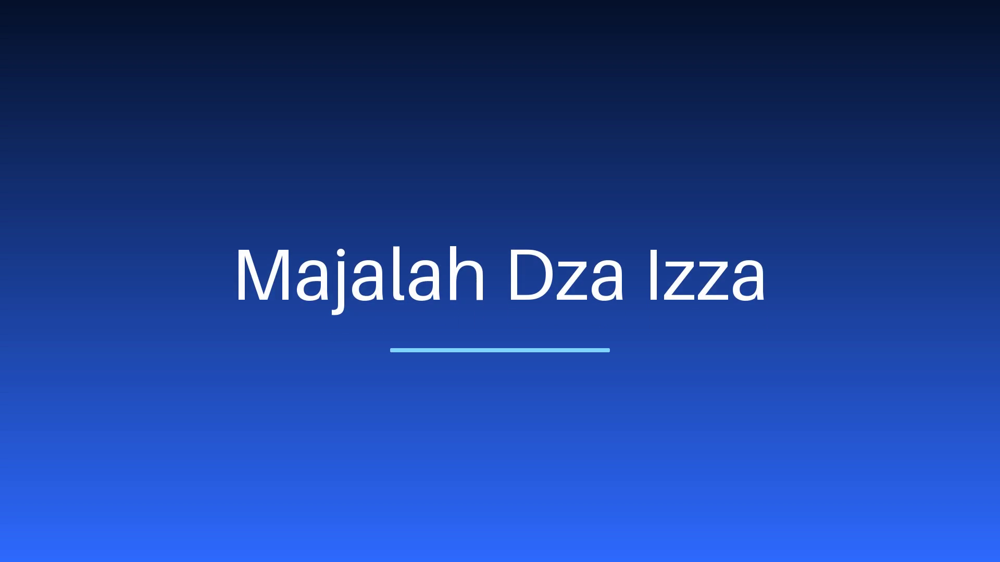

# EffectCraft Prompt Studio

Aplikasi desktop Windows (Python 3.11 + CustomTkinter) yang mengubah **prompt bahasa Indonesia/Inggris**
menjadi video motion graphics dengan cara **mengemudikan [EffectCraft](https://github.com/storytold/effectcraft)
secara langsung**: LLM hanya boleh mengeluarkan rencana animasi JSON, lalu *translator* berbasis kode
murni mengubahnya menjadi deretan command EffectCraft yang di-whitelist, menjalankannya, dan merender MP4.


---

## 0. Status kejujuran (baca ini dulu)

Proyek ini dibangun dan diuji di lingkungan Linux tanpa Windows, tanpa Rust/cargo, tanpa Docker, dan tanpa
binary EffectCraft. Karena itu ada perbedaan tegas antara **apa yang sudah dibuktikan** dan **apa yang baru
bisa dibuktikan di mesin Anda**:

| Bagian | Status di repo ini | Bukti / catatan |
|---|---|---|
| Prompt → rencana JSON → command (validator + translator) | **Terbukti** | 83 unit test; 5 prompt contoh (judul fade-in, lower third, logo reveal, countdown, intro YouTube) |
| Prompt → **MP4** end-to-end | **Terbukti**, tetapi dirender oleh **simulator internal** (Pillow + FFmpeg) | `docs/demo/intro-majalah-dza-izza.mp4` (1920×1080, 5 s, 30 fps, 150 frame) |
| Rendering oleh **EffectCraft asli** (CLI lokal / Docker) | **Belum terbukti di sini** — tidak ada `effectcraft-cli` maupun Docker di lingkungan build | Jalankan `python scripts/verify_with_effectcraft.py --mode local` di Windows; skrip mencetak setiap command + JSON hasil engine |
| GUI CustomTkinter (jendela, tab, dialog Settings) | **Belum pernah dijalankan** (Tk tidak tersedia di sandbox) | Kode lolos `py_compile` + uji statis AST (event handler, larangan `shell=True`, impor GUI terisolasi). Harap anggap UI sebagai "belum teruji runtime" |
| Panggilan LLM sungguhan (OpenAI/Anthropic) | **Belum diuji** ke API asli (tanpa API key/jaringan) | Parsing JSON, retry, dan penanganan error diuji dengan LLM palsu; tanpa key aplikasi tetap jalan dengan planner lokal |
| Image Docker `ghcr.io/storytold/effectcraft` | **Tidak terverifikasi** — repo EffectCraft tidak punya Dockerfile dan registry ghcr.io tidak bisa diakses dari sini | Nama image bisa diubah di Settings; `docker/Dockerfile` disediakan untuk membangun image sendiri |

Tidak ada klaim sukses palsu di README ini. Bagian [10. Limitasi](#10-limitasi--alternatif-jujur) merinci
semua keterbatasan beserta alternatifnya.

---

## 1. Fitur

1. **Kotak prompt + tombol “Buat Video”**, dengan opsi durasi, resolusi/rasio (720p 16:9, 1080p 16:9,
   vertikal 1080×1920 9:16, vertikal 720×1280 9:16, persegi 1:1), FPS (24/25/30/50/60), dan gaya
   (minimalis, neon, korporat, elegan, retro, bold, podcast, gelap).
2. **Pipeline 5 tahap**: LLM (opsional) → validasi skema JSON → translator whitelist → eksekusi EffectCraft →
   render MP4. Bila command gagal, pesan error engine dikirim balik ke LLM untuk memperbaiki rencana
   (maksimal 3 percobaan, dapat diatur 1–5), lalu ditampilkan sebagai error yang bisa dibaca manusia.
3. **Dua mode koneksi (+2 bonus)**: Lokal (`effectcraft-cli.exe`/`effectcraft.exe`, path bisa diatur, ada
   panduan `cargo build`), Docker (image + container opsional, folder proyek di-mount), Live (control channel
   port 9877, JSON per baris), dan Simulator internal. Mode **Otomatis** mendeteksi: lokal → Docker → live →
   simulator.
4. **Preview**: poster hasil render + tombol **Putar**, **Buka folder**, **Ekspor ulang**, dan tab
   **Rencana JSON** dengan **Validasi** serta **Simpan && Render Ulang** (edit rencana tanpa LLM).
5. **Riwayat proyek**: prompt, rencana JSON, `.ecproj`/snapshot, dan MP4 tersimpan per proyek di
   `Documents\EffectCraftPromptStudio`.
6. **Panel Log**: setiap command yang dijalankan beserta JSON hasilnya, plus log mentah CLI/Docker; bisa
   disalin ke clipboard.
7. **API key aman**: disimpan di **Windows Credential Manager** (bukan file teks), never logged, dan
   di-mask (`…abcd`) di UI.

---

## 2. Demo end-to-end

Prompt yang diminta:

> `Intro 5 detik, teks 'Majalah Dza Izza' muncul fade-in dengan latar gradasi biru`

Hasil: **[`docs/demo/intro-majalah-dza-izza.mp4`](docs/demo/intro-majalah-dza-izza.mp4)**



* 1920×1080 · 30 fps · 5,0 detik · 150 frame · H.264
* 25 command EffectCraft dijalankan (tersimpan di [`docs/demo/steps.json`](docs/demo/steps.json)),
  rencana JSON di [`docs/demo/plan.json`](docs/demo/plan.json), log lengkap di
  [`docs/demo/log.txt`](docs/demo/log.txt)
* Efek: layer solid `BG` + `Gradient Ramp` (#06122b → #2f6bff), aksen bar dengan animasi scale &
  opacity, teks `Majalah Dza Izza` fade-in + naik (keyframe opacity & position, `easyEase`)

> ⚠️ Video di atas dirender oleh **SIMULATOR internal** (Pillow + FFmpeg), **bukan** oleh EffectCraft.
> Simulator menafsirkan command yang sama (comp, layer, keyframe, efek) sehingga pipeline dan translator
> benar-benar dieksekusi. Untuk hasil asli EffectCraft, jalankan skrip verifikasi di Windows (bagian 8).
> Regenerasi demo: `python scripts/make_demo.py`.

---

## 3. Instalasi & menjalankan (Windows)

```powershell
git clone <repo-ini> effect-craft-ai
cd effect-craft-ai

py -3.11 -m venv .venv
.\.venv\Scripts\activate
pip install -r requirements.txt

python run.py            # membuka UI
```

Mode headless (tanpa GUI, berguna untuk uji cepat/CI):

```powershell
# pakai planner lokal + simulator (tanpa EffectCraft)
python run.py --prompt "Intro 5 detik, teks 'Majalah Dza Izza' muncul fade-in dengan latar gradasi biru" `
              --mode simulator --no-llm --out demo.mp4

# pakai EffectCraft asli
python run.py --prompt "Lower third nama 'Budi Santoso'" --mode local --cli-path "C:\path\effectcraft-cli.exe"

# lihat deteksi koneksi
python run.py --detect
python -m ecps --detect        # sama, bila PYTHONPATH=src
```

Di Linux/macOS (untuk pengembangan): `pip install -r requirements-simulator.txt` lalu pakai `--mode simulator`
(headless). UI tidak tersedia karena membutuhkan Tk; kredensial memakai fallback file 0600 yang ditandai
tidak aman.

---

## 4. Membuat `.exe` (PyInstaller, satu file)

```powershell
pip install pyinstaller
pyinstaller --clean --noconfirm effectcraft-prompt-studio.spec
# hasil: dist\EffectCraftPromptStudio.exe  (onefile, tanpa jendela konsol)
```

Catatan:

* Spec sudah mengumpulkan aset tema `customtkinter` (`collect_data_files`), menyertakan seluruh submodul
  `ecps`, dan memakai `assets/icon.ico`.
* FFmpeg untuk poster/preview disediakan oleh paket `imageio-ffmpeg` yang ikut terpaket. Bila ingin binary
  FFmpeg sistem, set `ECPS_FFMPEG` ke path `ffmpeg.exe` (lihat `src/ecps/ui/media.py`).
* `dist\EffectCraftPromptStudio.exe` pertama kali dijalankan bisa memicu SmartScreen (unsigned). Tanda tangani
  dengan sertifikat code-signing bila akan didistribusikan.
* Ukuran wajar ± 40–60 MB. Menjalankan exe dengan argumen (`--detect`, `--prompt "…"`, `--no-llm`) memakai
  mode headless tanpa membuka UI.

---

## 5. Menghubungkan ke EffectCraft

Semua nilai diatur di **Settings** dan disimpan di `%APPDATA%\EffectCraftPromptStudio\settings.json`
(tanpa API key).

### 5.1 Mode Lokal

1. Pasang EffectCraft dari [releases](https://github.com/storytold/effectcraft/releases) (installer Windows
   menyertakan `effectcraft-cli.exe`), **atau** bangun sendiri:
   ```powershell
   git clone https://github.com/storytold/effectcraft
   cd effectcraft
   cargo build --release -p effectcraft-cli
   # hasil: target\release\effectcraft-cli.exe
   ```
2. Set **Settings → Path effectcraft-cli** ke binary tersebut (atau biarkan kosong agar dicari otomatis).

Urutan pencarian otomatis: path di Settings → env `ECPS_EFFECTCRAFT_CLI` / `EFFECTCRAFT_CLI` → `PATH` →
`%LOCALAPPDATA%\Programs\ArtCraft\EffectCraft\` → `C:\Program Files\ArtCraft\EffectCraft\` →
folder aplikasi/`bin`/`tools`/`target\release` relatif terhadap repo.

Preflight menjalankan `effectcraft-cli info --empty --json` untuk memastikan versi & jumlah command/efek.
Bila tidak ditemukan, UI menampilkan panduan unduh/build (bukan error mentah).

### 5.2 Mode Docker

Aplikasi menjalankan (tanpa `shell=True`, argumen berupa list):

```
docker run --rm -v <folder-proyek>:/work <image> info --empty --json
docker run --rm -v <folder-proyek>:/work <image> run project.ecproj <json-command> --save
docker run --rm -v <folder-proyek>:/work <image> render project.ecproj --comp Main --out render.mp4 --fps 30
```

Bila kolom **container** diisi, aplikasi memakai `docker exec -w /work <container> effectcraft-cli …`
(menghindari start container baru setiap command).

> **Penting:** `ghcr.io/storytold/effectcraft` adalah nilai default yang **belum bisa kami verifikasi**
> (repo EffectCraft tidak menyertakan Dockerfile, dan ghcr.io tidak dapat diakses dari lingkungan build).
> Image resmi mungkin tidak ada — bangun sendiri:
>
> ```bash
> docker build -t effectcraft-cli:0.24.1 docker/
> docker run --rm -v "$PWD/projects:/work" effectcraft-cli:0.24.1 --help
> ```
>
> `docker/Dockerfile` melakukan multi-stage build Rust (`-p effectcraft-cli`) lalu menyalin binary ke
> `debian:bookworm-slim` dengan font DejaVu/Liberation. Isi **Settings → Image Docker** dengan tag hasil build.

Butuh Docker Desktop berjalan. Bila Docker belum terpasang/daemon mati, preflight melaporkan penyebabnya dan
aplikasi tidak mencoba mengeksekusi apa pun.

### 5.3 Mode Live (control channel, opsional)

Jalankan aplikasi EffectCraft dengan `effectcraft --control 9877` (default `127.0.0.1:9877`, TCP, satu objek
JSON per baris, tanpa autentikasi, timeout 60 detik per permintaan — sesuai
[`docs/control-protocol.md`](https://github.com/storytold/effectcraft/blob/main/docs/control-protocol.md)).
Mode ini mengirim `engine.execute` untuk membangun proyek di instance yang sedang berjalan. **Render tetap
lewat CLI** karena subcommand `render` menolak `--bridge`.

### 5.4 Mode Simulator

Implementasi internal (`src/ecps/runner/simulator.py`) yang menafsirkan command whitelist dengan Pillow dan
menulis MP4 via FFmpeg. Tujuannya: pipeline tetap bisa didemokan/diuji tanpa EffectCraft. Semua hasilnya
diberi label **SIMULATOR** di UI, log, dan `EngineResult.warnings`. Ini **bukan** pengganti renderer
EffectCraft (font, compositing, dan efek tidak identik).

### 5.5 Mode Otomatis

Urutan: lokal (preflight `info`) → Docker (`docker version` + image/container) → live (port terbuka) →
simulator. Notifikasi di header menjelaskan pilihan dan alasannya.

---

## 6. LLM & keamanan kredensial

* **Provider**: `openai` (endpoint apa pun yang kompatibel `/chat/completions`, termasuk OpenRouter, Groq,
  LM Studio, Ollama dengan base URL sendiri) dan `anthropic` (`/v1/messages` + `anthropic-version`).
* **Model default**: `gpt-4o-mini`; base URL default `https://api.openai.com/v1`. Ganti di Settings.
* **API key** disimpan lewat `CredentialStore` → Windows Credential Manager tipe generik dengan target
  `EffectCraftPromptStudio/openai` atau `EffectCraftPromptStudio/anthropic` (implementasi `ctypes`/`advapi32`,
  tanpa `keyring`).
  * Key tidak pernah ditulis ke `settings.json`, proyek, atau log; UI hanya menampilkan `…abcd`.
  * Bila pembacaan gagal, `CredentialError` ditampilkan dan aplikasi menawarkan planner lokal.
  * Di luar Windows dipakai fallback `secrets.json` (0600) yang ditandai jelas **tidak aman** (khusus dev).
* **Tanpa key / offline / key salah**: aplikasi **tidak berhenti** — ia memakai **planner lokal**
  deterministik (`src/ecps/planner/local_planner.py`) yang mendukung judul, lower third, logo reveal,
  countdown, dan intro YouTube. Error `401/403` (key salah) dan `URLError/timeout` (offline) dilaporkan di log.

### Yang boleh dikeluarkan LLM

Hanya satu objek JSON (skema di bawah). LLM **tidak pernah** mengeluarkan command, path file, nama file, atau
argumen proses. Bila JSON tidak valid / melanggar skema / gagal di engine, prompt perbaikan membawa rencana
sebelumnya + pesan error spesifik, lalu LLM diminta memperbaikinya (maksimal 3 percobaan).

---

## 7. Arsitektur & alur

```
prompt (UI)
   │  planner: LLM (strict JSON)  ──gagal──► planner lokal (fallback)
   ▼
plan JSON ──validate_plan()──► Plan (comp/layers/keys/effects)   [planner/schema.py]
   ▼
translate(plan) ──► [Step(command, params), …]                    [translator/translate.py]
   │                  hanya command & properti dalam whitelist     [translator/whitelist.py]
   ▼
runner.build(steps)  ── error? ──► pesan engine → LLM → rencana baru (≤3x)
   ▼
runner.render(project, render.mp4)
   ▼
storage/projects.py (prompt, plan.json, steps.json, project.ecproj, render.mp4, log.txt)
   ▼
UI: poster + Putar / Buka folder / Ekspor ulang / Edit rencana JSON
```

```
src/ecps/
├── config.py            Settings + SettingsStore + RESOLUTIONS/STYLES + path folder
├── errors.py            EcpsError, PlanError, TranslationError, RunnerError, LlmError, CredentialError, PipelineError
├── pipeline.py          orkestrasi plan → translate → build → render (+ perbaikan berulang)
├── cli.py               mode headless (prompt → MP4)
├── security/            CredentialStore (Windows Credential Manager) + sanitasi nilai
├── planner/             schema.py (dataclass + validator + PLAN_SCHEMA_TEXT), local_planner.py
├── llm/                 client.py (urllib, tanpa SDK), prompts.py (system+repair prompt)
├── translator/          whitelist.py (command/efek/properti), translate.py (plan → step)
├── runner/              process.py (subprocess list, timeout), local.py, docker.py, control.py,
│                        simulator.py, detect.py, base.py
├── storage/             projects.py (riwayat per proyek)
└── ui/                  app.py, settings_dialog.py, media.py (poster/FFmpeg/buka file)
```

### Whitelist (hanya ini yang bisa dieksekusi)

Semua nama diambil dari `docs/agents.md` + source `crates/engine/src/cmd/*` EffectCraft v0.24.1
(lihat `docs/effectcraft-research.md`).

| Command | Kegunaan |
|---|---|
| `comp.new` | buat komposisi (`name,width,height,frameRate,duration,background`) |
| `layer.newSolid` | layer solid/warna (`name,color,width,height,position`) |
| `layer.newShape` | bentuk (`rect/rounded/ellipse/star/polygon`, `size`, `fill`, `position`) |
| `layer.newText` | teks (`text,size,fill,justify,font,style,tracking,position`) |
| `effect.apply` | pasang efek (`layer,effect`) |
| `prop.set` | set properti termasuk parameter efek `effects/#<n>/<param>` |
| `prop.addKey` | keyframe (`layer,path,time,timeBase:"comp",value`) |
| `keys.select` | pilih keyframe (`layer,path,keys,timeBase`) |
| `keys.easyEase` / `keys.interpolation` | easing |
| `layer.timing` | trim layer (`layers,in,out`) |

Properti yang boleh dianimasikan: `transform/position`, `transform/scale`, `transform/rotation`,
`transform/opacity`, `transform/anchor`. Efek yang dikenali: 27 efek spec-form (Gradient Ramp, Glow, Tint,
Gaussian Blur, Drop Shadow, Fill, Mosaic, Venetian Blinds, …) — `effects_doc()` membangkitkan daftar ini untuk
prompt LLM.

> Detail penting: **`Glow.opacity` bertipe Angle** — jangan dipakai untuk fade. Fade selalu lewat
> `transform/opacity`.

---

## 8. Verifikasi dengan EffectCraft asli

```powershell
# 1) deteksi koneksi
python scripts/verify_with_effectcraft.py --detect

# 2) render demo dengan CLI lokal (semua command + JSON dicetak)
python scripts/verify_with_effectcraft.py --mode local --cli-path "C:\...\effectcraft-cli.exe"

# 3) render demo via Docker (image hasil build sendiri)
python scripts/verify_with_effectcraft.py --mode docker --image effectcraft-cli:0.24.1

# 4) coba LLM asli (butuh API key tersimpan)
python scripts/verify_with_effectcraft.py --mode local --llm
```

Skrip menolak mengklaim sukses bila yang terdeteksi hanya simulator, menampilkan langkah gagal beserta nomor
step-nya, dan menyalin hasil ke `docs/demo/effectcraft-asli.mp4`.

---

## 9. Uji otomatis

```bash
pip install -r requirements-simulator.txt
python -m pytest          # 83 test (pythonpath & testpaths diatur di pyproject.toml)
```

| Berkas | Isi |
|---|---|
| `tests/test_schema.py` | validator: field wajib, tipe, warna, durasi keyframe, key harus naik, easing, dedup nama layer |
| `tests/test_translator.py` | **5 prompt contoh** → command: whitelist, konversi titik gradasi `[0.5,0]`→`[960,0]`, efek tak dikenal, parameter salah, alias efek, `justify`, keyframe `easyEase` |
| `tests/test_pipeline.py` | alur penuh dengan runner & LLM palsu: perbaikan setelah error translator, perbaikan setelah error engine, gagal setelah 3 percobaan, fallback planner lokal, render ulang |
| `tests/test_simulator.py` | build+render MP4 sungguhan (720p/1,2 s), nomor step pada error, gradasi & teks terlihat di frame |
| `tests/test_runner_detect.py` | deteksi otomatis (lokal > Docker > simulator), larangan `shell=True`, argv berbentuk list |
| `tests/test_misc.py` | whitelist, planner lokal, sanitasi input, CredentialStore, ProjectStore |
| `tests/test_ui_static.py` | AST UI + semua jenis event tertangani + impor GUI tidak bocor ke mode headless |

Fixture: `tests/fixtures/prompts.json` (5 prompt) dan `tests/fixtures/plans/*.json` (rencana hasil planner lokal).

---

## 10. Limitasi & alternatif (jujur)

1. **Rendering EffectCraft asli belum dijalankan di sini.** Tidak ada Windows, Rust, atau Docker di lingkungan
   build, dan unduhan binary rilis gagal (`SSL_ERROR_SYSCALL` ke `release-assets.githubusercontent.com`).
   *Alternatif*: `scripts/verify_with_effectcraft.py` (bagian 8) untuk membuktikan di mesin Anda; demo di repo
   memakai simulator dan diberi label demikian di mana-mana.
2. **GUI belum dites runtime.** `customtkinter`/`tkinter` tidak tersedia di sandbox sehingga jendela tidak
   pernah dibuka; kode diverifikasi secara statis (parse AST, penanganan event, tidak ada `shell=True`).
   Risiko: kesalahan tata letak/argumen widget yang hanya muncul saat dijalankan.
   *Alternatif*: jalankan `python run.py` di Windows; semua logika non-UI sudah dites dan bisa dipakai lewat CLI.
3. **Preview tidak memutar video di dalam jendela.** CustomTkinter tidak punya video widget; aplikasi
   menampilkan poster hasil render dan tombol **Putar** membuka MP4 di pemutar default Windows (tombol Buka
   folder / Ekspor ulang juga tersedia). *Alternatif*: port UI ke PySide6 + `QtMultimedia` (perlu
   pendekatan ulang `ui/`) atau sematkan WebView yang memutar file lokal.
4. **Nama image Docker belum terverifikasi.** Tidak ada Dockerfile di repo EffectCraft dan ghcr.io tidak bisa
   dihubungi. *Alternatif*: `docker/Dockerfile` (disertakan) + kolom image yang bisa diubah.
5. **Efek & properti terbatas pada whitelist.** EffectCraft punya ±699 command dan 308 efek; aplikasi sengaja
   hanya memakai 11 command dan 27 efek yang terdokumentasi agar translator aman dan deterministik.
   *Alternatif*: tambahkan entri di `translator/whitelist.py` (nama, tipe param, contoh) setelah memeriksa
   `effectcraft-cli exec --schemas --json`.
6. **Parameter efek bertitik ternormalisasi hanya untuk layer solid.** `Gradient Ramp`/`Grid`/`Checkerboard`
   memakai titik `[0..1]` relatif ukuran layer; untuk layer teks/bentuk nilainya harus piksel.
   Translator menolak (bukan menebak) bila dikirim pada layer non-solid.
7. **Tidak ada editor timeline/keyframe visual.** Mengedit animasi dilakukan lewat tab **Rencana JSON**
   (validasi + render ulang). *Alternatif*: tambahkan form per-layer di atas `planner/schema.py`.
8. **Simulator bukan tiruan sempurna.** Font sistem berbeda, efek didekati (gradasi, glow, blur, dsb.),
   dan parameter efek lanjutan diabaikan. Video simulator tidak boleh dipakai sebagai bukti kualitas
   EffectCraft.
9. **Mode Live terbatas.** Control channel dipakai untuk `engine.execute` (membangun proyek di instance yang
   berjalan) — render tetap via CLI karena `render` menolak `--bridge`. Protokol tidak punya autentikasi dan
   hanya untuk loopback.
10. **LLM belum diuji terhadap API asli** (tanpa key/jaringan): hanya parsing, retry, dan jalur error yang
    diuji. Model yang lemah bisa gagal mematuhi skema → setelah 3 percobaan aplikasi berhenti dengan pesan
    jelas, atau Anda bisa memakai planner lokal.
11. **Teks yang diekstrak dari prompt bersifat heuristik** (tanda kutip > setelah kata “teks/judul”, maksimal
    120 karakter). Untuk hasil presisi, edit rencana JSON sebelum render.
12. **PyInstaller onefile** memperlambat start (ekstraksi ke `%TEMP%`) dan dapat memicu antivirus; alternatif
    `--onedir` dengan menambahkan `COLLECT(...)` pada spec.

---

## 11. Troubleshooting

| Gejala | Penyebab & solusi |
|---|---|
| Header menampilkan **SIMULATOR** | Tidak ada CLI/Docker/live. Isi path CLI di Settings, jalankan Docker Desktop, atau pasang EffectCraft |
| “effectcraft-cli tidak ditemukan” | Isi **Path effectcraft-cli**, set env `ECPS_EFFECTCRAFT_CLI`, atau build dengan `cargo build --release -p effectcraft-cli` |
| “Docker tidak ditemukan / daemon tidak menjawab” | Pasang & jalankan Docker Desktop, tunggu status *running* |
| Preflight gagal pada `info` | Binary terlalu lama/rusak; pakai rilis EffectCraft terbaru (diuji terhadap v0.24.1) |
| Render gagal di step N | Log menampilkan command + JSON error engine; pesan yang sama dikirim ke LLM untuk diperbaiki |
| Key salah (401/403) | Perbaiki di Settings → API key (Credential Manager); aplikasi beralih ke planner lokal |
| Offline | Planner lokal tetap berfungsi; LLM otomatis dimatikan untuk sesi itu |
| Video tidak muncul di preview | FFmpeg tidak ada → poster dilewati, tombol Putar tetap berfungsi |
| Video tanpa audio | Memang hanya video (video-only renderer); tambahkan audio di editor eksternal bila perlu |

---

## 12. Atribusi & referensi

* [storytold/effectcraft](https://github.com/storytold/effectcraft) v0.24.1 — `docs/agents.md`,
  `docs/control-protocol.md`, README, dan source `crates/engine` + `crates/effects` sebagai sumber tunggal
  nama command/argumen.
* Ringkasan riset (command, format JSON, alur render, control protocol): [`docs/effectcraft-research.md`](docs/effectcraft-research.md).
* Ikon & demo dibuat untuk repo ini. Tidak ada aset pihak ketiga selain font sistem.
